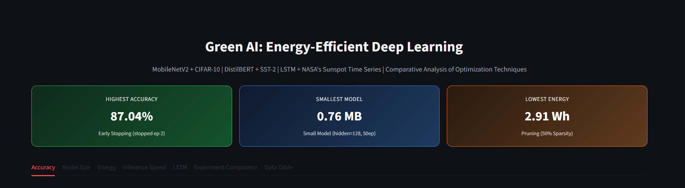
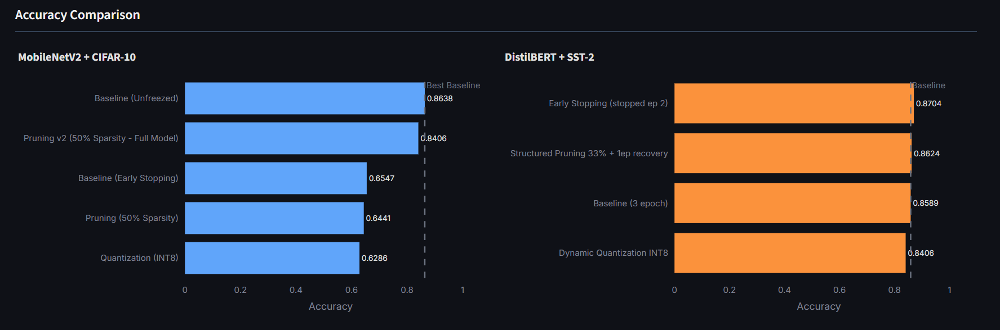
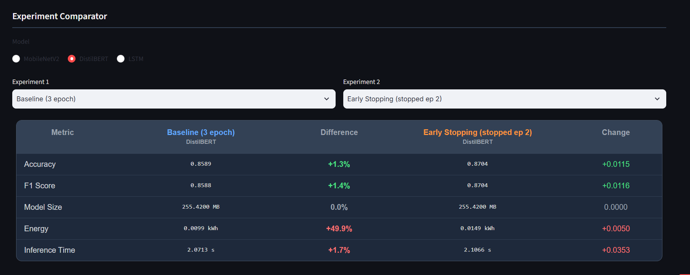

# Green AI: Energy-Efficient Deep Learning

**A controlled comparison of three model-compression techniques — dynamic INT8 quantization, structured pruning, and early stopping — across three architectures and modalities.**

Most compression studies look at one technique on one architecture. This project runs all three techniques against an image model (MobileNetV2 + CIFAR-10), a text model (DistilBERT + SST-2), and a time-series model (LSTM + NASA Sunspot), under one shared experimental protocol — **13 experiments, one combined results set, one interactive dashboard** — to answer a single question: *can you cut energy and model size without meaningfully hurting accuracy, and if so, when?*

> **🔗 Live dashboard:** **https://green-ai-energy-efficient-deep-learning-k9xeprj3wbgnogxsgtbojc.streamlit.app/**
> _(Free hosting — if it hasn't been visited recently, the first load may take ~30s to wake up.)_



<!-- Suggested badges — keep or trim:


-->

---

## Key findings

**1. Quantization shrinks files but *slows down* CPU inference — the same way on every architecture.**
Dynamic INT8 quantization cut model size by **48–74%** across all three models, yet made CPU inference **40–160% slower** every time. The INT8↔FP32 conversion overhead outweighs any vectorization gain at small batch sizes on CPU. Because three independent architectures show the identical pattern, this is a hardware-level result, not a one-model fluke.
*Takeaway: on CPU, quantization buys you storage and memory — not speed, and not energy.* The real energy wins in this project came from **right-sizing and pruning**, not from the most obvious "green" technique.

**2. A technique's payoff depends on where a model's parameters live — not on the data type.**
- **DistilBERT:** removing 33% of attention heads cut only **7.1%** of parameters, because most of a transformer's weight budget sits in the feed-forward (FFN) layers, not attention.
- **MobileNetV2:** the first pruning run barely changed model size — it had only touched the trainable Dense head (~0.56% of parameters) while the frozen backbone stayed untouched. Rather than accept "pruning doesn't work," I unfroze the full model and added two control experiments; the real effect then appeared: **−78% compressed size for ~2.3 points of accuracy.**
- **LSTM:** halving hidden units (256→128) gave **−75% size and −61% inference time for +6.8% MAE** — the baseline was simply over-provisioned for the task.

**3. Early stopping is only as good as the model's convergence speed.**
On DistilBERT it caught overfitting at epoch 2 and produced the project's **highest accuracy (87.04%)**. On the slow-converging LSTM — still improving at 50 epochs — the *same technique* landed behind baseline. No technique is universally "good"; it has to be read against the model's own training dynamics.

> **The one-line message:** there is no single technique that saves energy on every model. The right move is to match the technique to each architecture's structure — which is exactly what a controlled, apples-to-apples comparison lets you do.

---

## The dashboard

All 13 experiments are explorable in a Streamlit + Plotly dashboard with seven tabs (Accuracy, Model Size, Energy, Inference Speed, LSTM, an Experiment Comparator that only allows within-model comparisons so you can't accidentally compare across modalities, and a raw Data Table). Total measured energy across every experiment — **78.6 Wh (~5.2 phone charges, ~23.7 g CO₂)** — is surfaced on the landing page to keep the "Green AI" framing concrete rather than abstract.

<!-- Add 1–2 more screenshots. Put the images in an assets/ folder and update the paths: -->



---

## Results at a glance

| Model | Experiment | Accuracy / F1 | MAE / RMSE | Size (MB) | Energy |
|---|---|---|---|---|---|
| MobileNetV2 | Baseline (frozen + early stopping) | 65.5% / 0.65 | — | 9.27 | 8.41 Wh |
| MobileNetV2 | Quantization (INT8) | 62.9% / 0.63 | — | **2.60** | — |
| MobileNetV2 | Pruning — Dense only (50%) | 64.4% / 0.64 | — | 9.16 | 2.91 Wh |
| MobileNetV2 | Pruning v2 — full model (50%) | 84.1% / 0.84 | — | 9.16 (comp. 5.14) | 16.22 Wh |
| MobileNetV2 | Baseline — unfrozen | 86.4% / 0.86 | — | 26.34 (comp. 23.72) | 21.28 Wh |
| DistilBERT | Baseline (3 epochs) | 85.9% / 0.86 | — | 255.42 | 9.94 Wh |
| DistilBERT | Dynamic Quantization INT8 | 84.1% / 0.84 | — | **132.29** | — |
| DistilBERT | Structured Pruning (33% heads) | 86.2% / 0.86 | — | 237.40 | 4.98 Wh |
| DistilBERT | Early Stopping (best ep 2) | **87.0% / 0.87** | — | 255.42 | 14.90 Wh |
| LSTM | Baseline (hidden=256) | — | 38.68 / 49.76 | 3.02 | 0.036 Wh |
| LSTM | Dynamic Quantization INT8 | — | 38.69 / 49.77 | **0.77** | — |
| LSTM | Early Stopping (best ep 5) | — | 42.40 / 48.92 | 3.02 | 0.011 Wh |
| LSTM | Small model (hidden=128) | — | 41.30 / 51.40 | **0.76** | 0.015 Wh |

> Note on the MobileNetV2 jump from 65% → 84%: that gain comes from **unfreezing the backbone**, not from pruning. The fair read of pruning's effect is *pruned-full (84.1%) vs. unfrozen baseline (86.4%)* ≈ −2.3 points for a ~78% size cut.

---

## What's in here

| Path | What it does |
|---|---|
| `app.py` | The Streamlit dashboard (entry point) |
| `notebooks/01_mobilenetv2_cifar10_optimization.ipynb` | MobileNetV2 + CIFAR-10: baseline, quantization, pruning (Dense-only and full-model) |
| `notebooks/02_distilbert_sst2_optimization.ipynb` | DistilBERT + SST-2: baseline, dynamic quantization, manual attention-head pruning, early stopping |
| `notebooks/03_LSTM_optimization.ipynb` | LSTM + NASA Sunspot: baseline, dynamic quantization, early stopping, hidden-size reduction |
| `notebooks/visualization.ipynb` | Builds the comparison charts from the merged results |
| `notebooks/results/all_results.csv` | Combined results — one row per experiment |

Run the notebooks in order — `visualization.ipynb` depends on the result files the first three produce.

---

## Methods in brief

- **Techniques:** dynamic INT8 quantization, structured pruning (Dense weights in MobileNetV2; attention heads in DistilBERT — removed manually because `prune_heads` was broken for DistilBERT in the installed Transformers version; hidden-unit reduction in LSTM), and early stopping.
- **Metrics:** accuracy / F1 for classification, MAE / RMSE for the time-series task, plus model size, inference time, and energy for every experiment.
- **Energy measurement:** [CodeCarbon](https://github.com/mlco2/codecarbon) `OfflineEmissionsTracker` (country code TUR).

---

## Run it locally

```bash
pip install -r requirements.txt
streamlit run app.py
```

---

## Notes & limitations (by design)

- **CPU-only, Windows.** This is a deliberate choice, not a shortcut: energy efficiency is most relevant where there's no GPU to lean on, and it also keeps the quantization inference-overhead finding (above) honest and measurable.
- **Scaled/subset data** (CIFAR-10 at 64×64, a 5,000-example SST-2 subset, ~3,000 sunspot points) lowers *absolute* scores but doesn't affect the *relative* comparisons, since every experiment ran under identical conditions.
- **CodeCarbon precision.** LSTM energy fell below the tool's resolution (~0.01–0.04 Wh), so LSTM is evaluated on size and inference speed rather than energy. Energy figures are best read as relative, not absolute.

---

## Attribution

Developed under the **TÜBİTAK 2209-A** University Students Research Projects Support Program (Apr 2025 – Jul 2026).
**Researcher:** Bahar Erol · **Supervisor:** Prof. Dr. Zafer Cömert